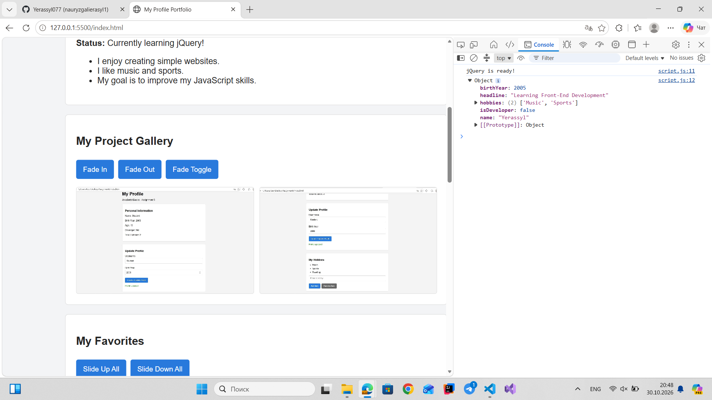
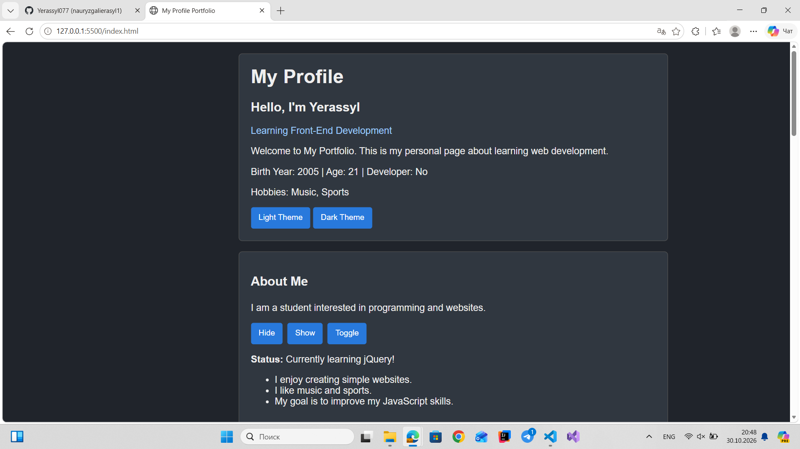
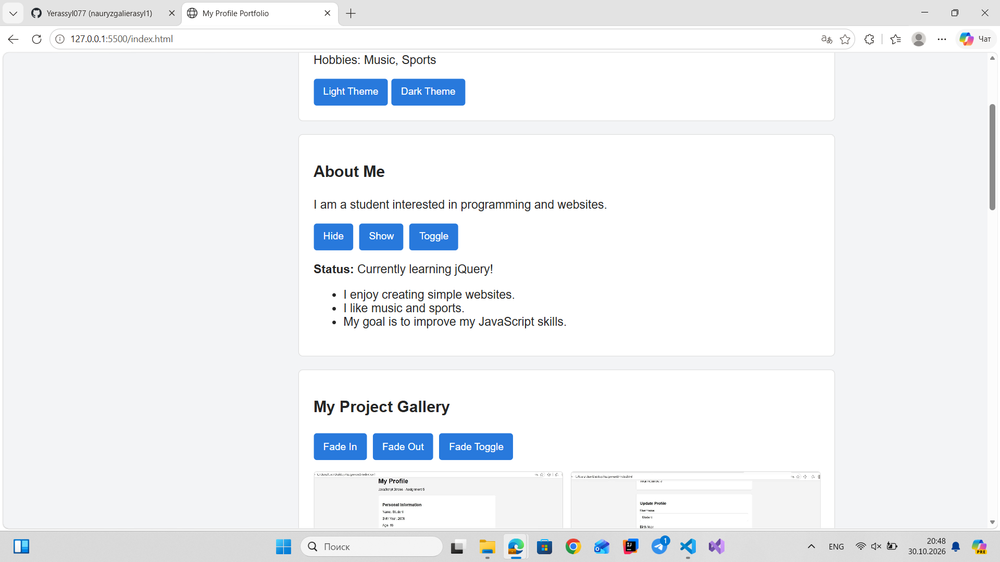
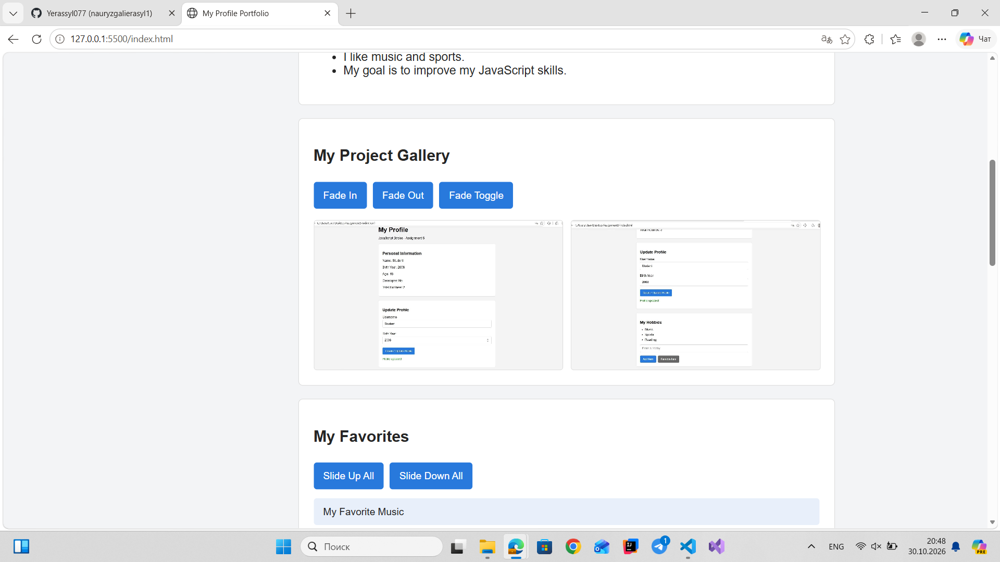
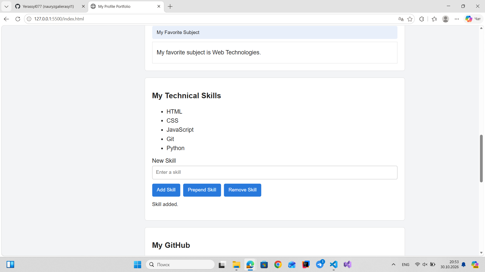
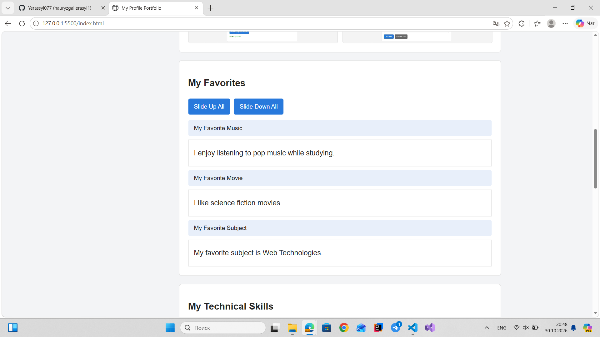
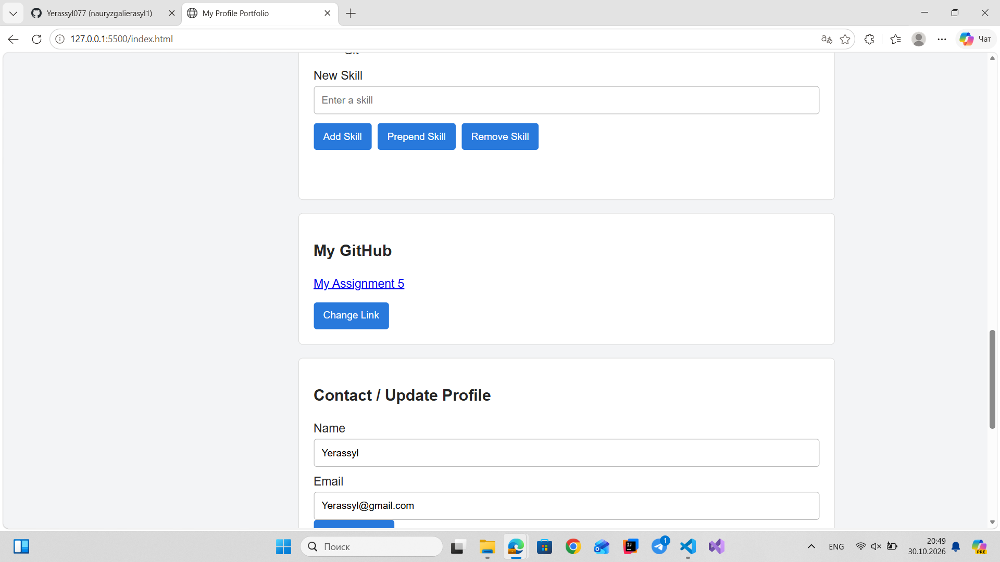
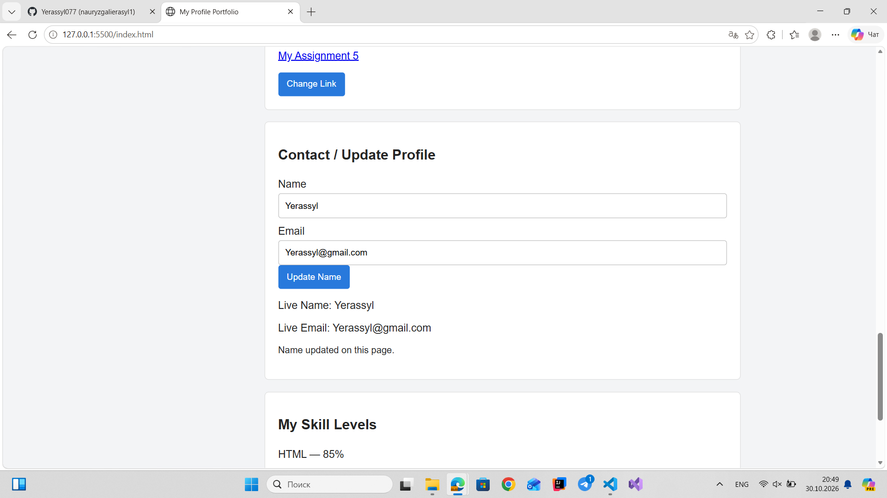
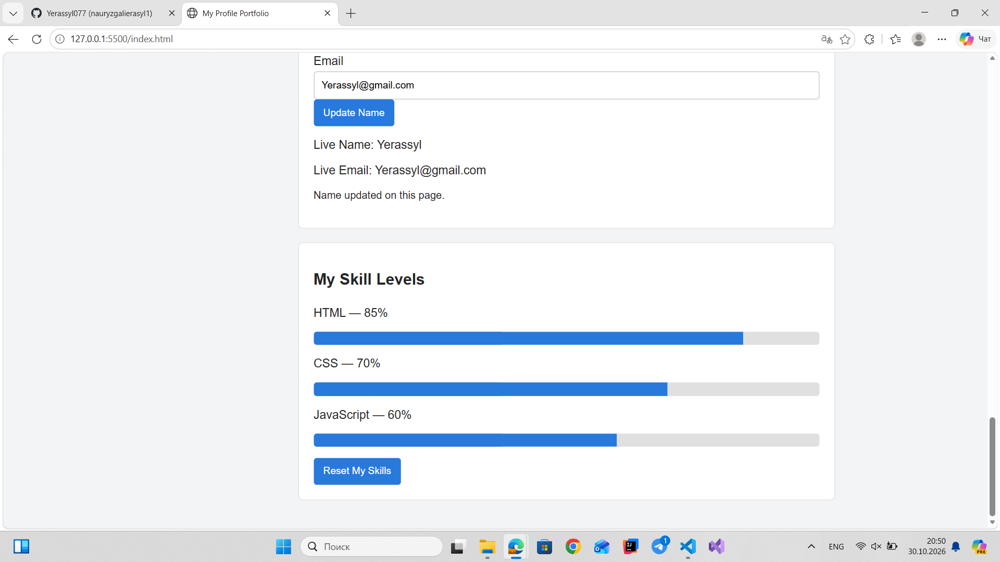

# Assignment 6 - jQuery Portfolio

**Name:** Your Name  
**Group:** IT-2513  
**Subject:** Web Technologies 1 (Front-End Development)

## Objective

The objective of this assignment is to practice jQuery selectors, DOM manipulation, event handling, effects, and animations.

I continued the personal profile theme from Assignment 5 and expanded it into a simple interactive portfolio website. The page includes profile information, an About Me section, a gallery, technical skills, a contact form, and animations.

## Task 0 - jQuery Setup

I connected the jQuery library using a CDN and used `$(document).ready()` to run JavaScript after the page is loaded.

I tested the connection by displaying "jQuery is ready!" in the browser console.

## Task 1 - Selectors and CSS

I created a personal profile section with my name, headline, short introduction, and basic information.

I used tag, ID, and class selectors to access HTML elements. The `.text()` method updates the displayed information, and `.css()` changes element styles.

I also added Light Theme and Dark Theme buttons to change the appearance of the page.

## Task 2 - Visibility Methods

I created an About Me section with a short biography, current learning status, and some personal facts.

I added three buttons: Hide, Show, and Toggle. They use `.hide()`, `.show()`, and `.toggle()` to control the visibility of the content.

## Task 3 - Fade Methods

I created a small gallery with two screenshots from my previous profile project.

I used `.fadeIn()`, `.fadeOut()`, and `.fadeToggle()` to show and hide the images with smooth fading effects.

## Task 4 - Slide Methods

I created three expandable sections about my favorite music, movie, and subject.

Each heading can be clicked to open or close its information using `.slideToggle()`.

I also added buttons that use `.slideUp()` and `.slideDown()` to close or open all sections.

## Task 5 - Add and Remove Elements

I created a list containing four technical skills: HTML, CSS, JavaScript, and Git.

The user can enter a new skill and add it to the beginning or end of the list.

I used `.append()`, `.prepend()`, and `.remove()` to modify the list. Empty values are not accepted.

## Task 6 - Modifying Attributes

I added a link to my GitHub profile and a Change Link button.

When the button is clicked, the `.attr()` method changes the link destination between my GitHub profile and my previous assignment repository.

## Task 7 - Form Interaction

I created a form with Name and Email input fields.

The form uses `.val()` to read user input and `.text()` to display the information immediately below the form.

The user can also submit the form to update the name shown in the profile.

## Task 8 - Basic Animation

I created three skill bars representing HTML, CSS, and JavaScript.

Initially, all bars have zero width.

The Animate My Skills button uses `.animate()` to increase each bar to a different width. Clicking the button again returns all bars to zero.

## Technologies Used

- HTML5
- CSS3
- JavaScript
- jQuery 3.7.1

## How to Run

1. Download the project from GitHub.
2. Open the project folder in Visual Studio Code.
3. Open `index.html` using Live Server.
4. Make sure an internet connection is available to load jQuery.
5. Test the theme buttons, effects, gallery, skills list, links, form, and animations.
6. Use F12 to open the browser console and view the jQuery setup message.

## Summary

During this assignment, I practiced selecting HTML elements and changing their content and styles using jQuery.

I learned how to handle button clicks, use visibility and animation effects, modify lists and attributes, and display input values in real time.

The final result is a personal portfolio website with interactive sections and simple animations.